```text
██████╗  █████╗ ██████╗  █████╗ ██████╗
██╔══██╗██╔══██╗██╔══██╗██╔══██╗██╔══██╗
██████╔╝███████║██║  ██║███████║██████╔╝
██╔══██╗██╔══██║██║  ██║██╔══██║██╔══██╗
██║  ██║██║  ██║██████╔╝██║  ██║██║  ██║
╚═╝  ╚═╝╚═╝  ╚═╝╚═════╝ ╚═╝  ╚═╝╚═╝  ╚═╝

   AWS shipped it. Claude read it. Your team got the brief.
```

<p align="center">
  <b>Because "I'll catch up on security news later" is not a security strategy.</b>
</p>

<p align="center">
  
  
  
  
  
</p>

> **Independent community project, not affiliated with or endorsed by Amazon Web Services.** "AWS" names the news source the radar reads. The weekly review is AI-assisted. Titles, dates and links come straight from AWS sources, but always confirm details in the linked page before acting on them.

<p align="center"><a href="https://g1c4bumm.github.io/aws-security-launch-radar-latam/"><b>Kit page</b></a> · <a href="demo/opening.html">Opening deck</a> · <a href="examples/email-en.html">Sample email</a> · <a href="ROADMAP.md">Roadmap</a></p>

---

## What is it?

Every week AWS publishes dozens of security launches, blog posts and bulletins. Someone on the team skims a few on Monday. Two weeks later, nobody remembers which CVE touched which tool.

The **AWS Security Weekly Radar** is a Claude Code skill that reads the last 7 days of AWS security news for you and sends one short review, by email and Slack, in **English, Portuguese or Spanish**:

- a **headline** for the week,
- **3 to 7 highlights**, each with priority, why it matters and one suggested action,
- **also released**: the rest of the relevant news, split into **NEWS** and **BLOG**,
- **good to know**: every new CVE and security bulletin of the week in one compact table.

Three curator agents work in parallel, an independent reviewer agent checks their work, and the scripts guarantee the facts: titles, dates and links come only from official AWS sources, and **nothing is sent if validation fails**.

## Features

| | Feature | Why it matters |
|---|---|---|
| 1 | **One request: `run the security radar`** | The whole weekly cycle in Claude Code: collect, curate, validate, render, send |
| 2 | **Multi-agent curation** | Three `radar-curator` subagents curate threats, identity and data-network in parallel; a `radar-reviewer` subagent that did not write the radar checks it before the validator |
| 3 | **Three report languages** | `en`, `pt-BR` or `es`, chosen once at setup |
| 4 | **Validator before every send** | Blocks invented items, URLs in text, unknown fields and bulletins in the wrong place |
| 5 | **NEWS, BLOG and UPDATED tags** | You see at a glance what is a launch, a blog post or an old bulletin AWS updated |
| 6 | **Email, Slack and a LinkedIn post** | Gmail connector and Slack webhook after a preview, plus a ready-to-paste LinkedIn post with bold headings, even with no connector at all |
| 7 | **Weekly routine** | Runs every Monday in the cloud, without questions, and reports what it did |
| 8 | **Examples and demo** | Real rendered reports in three languages in `examples/`, a 20-minute demo in `demo/` |

## What you need

| Item | Required? | What for |
|---|---|---|
| **Claude Code**, signed in with your Claude account | Yes | Runs the skill |
| **Python 3.9 or later** (standard library only) | Yes | Runs the four scripts |
| **Gmail connected** to your Claude account | For email | Sends the review from your Gmail address |
| **A Slack workspace** where you can add apps | For Slack | Posts the review to a channel |
| 15 minutes | Yes, once | Install, configure and see the first review |

## Getting started

Two phases: **set up once** (steps 1 to 5, about 15 minutes) and **use** (steps 6 and 7).

> Screens labeled **illustration** show third-party pages (Gmail connector, Slack app, routine) with fictional data. The script output, the email and the Slack message are real, rendered from `examples/`; only the `git clone` URL is a placeholder.

### Phase 1. Set up once

#### Step 1. Get your private copy

On GitHub, choose **Use this template › Create a new repository** and set it to **Private**. Do not fork: a fork of a public repository is always public, and your copy will hold your recipients. Then clone it. The weekly routine clones this copy.

```text
git clone https://github.com/<your-user>/aws-security-launch-radar-latam.git
cd aws-security-launch-radar-latam
```

Claude Code finds the skill in `.claude/skills/security-launch-radar/` when you start it from this folder.

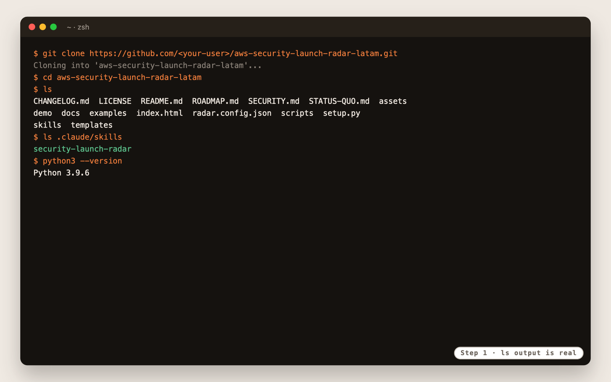

#### Step 2. Check that the sources are reachable

```text
python3 .claude/skills/security-launch-radar/scripts/fetch_feeds.py
```

`fetch_feeds.py` reads AWS What's New, the AWS security blogs and the Security Bulletins for the last 7 days. One line like the one below means all three are reachable. An `ERROR` line means a proxy or firewall is in the way.

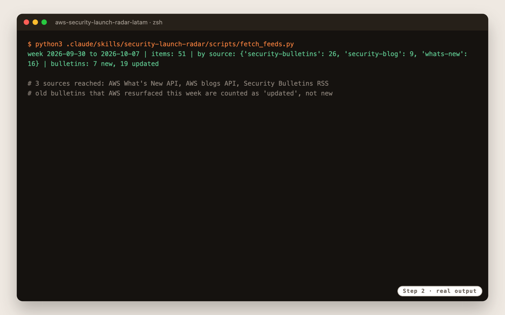

#### Step 3. Connect Gmail

Open [claude.ai/customize/connectors](https://claude.ai/customize/connectors), connect **Gmail** and approve it with the account that should send the review. Claude Code and the weekly routine both use this connector.

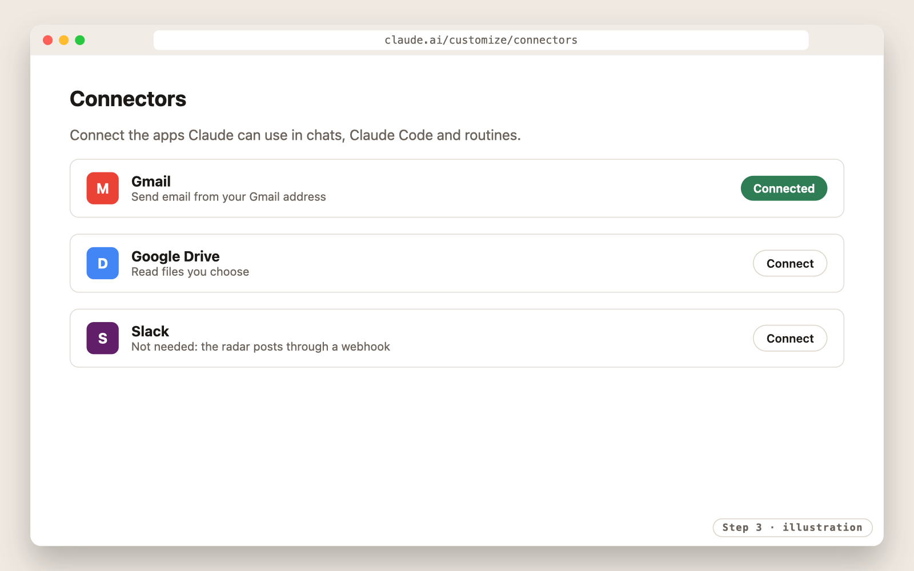

#### Step 4. Create a Slack webhook (optional)

1. At [api.slack.com/apps](https://api.slack.com/apps), choose **Create New App**, then **From scratch**, and pick your workspace.
2. Open **Incoming Webhooks**, turn it on, choose **Add New Webhook to Workspace** and pick the channel, for example `#security-radar`.
3. Export the URL in your shell. **Never put it in a file or in the repository.**

```text
export SLACK_WEBHOOK_URL=https://hooks.slack.com/services/...
```

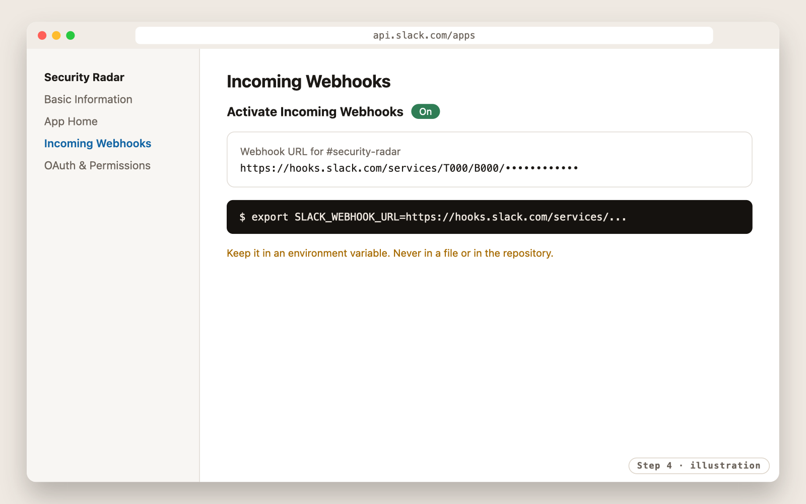

#### Step 5. Choose the language and recipients

```text
python3 setup.py
```

Three questions: report language, email recipients and Slack yes or no. Or all at once:

```text
python3 setup.py --language pt-BR --email security@example.com,ciso@example.com --slack
```

| Language | `--language` | Report title |
|---|---|---|
| English | `en` | AWS Security Weekly Radar |
| Português (Brasil) | `pt-BR` | Radar Semanal de Segurança AWS |
| Español | `es` | Radar Semanal de Seguridad AWS |

`setup.py` writes `radar.config.json`. Commit it to your private copy so the routine uses the same settings.

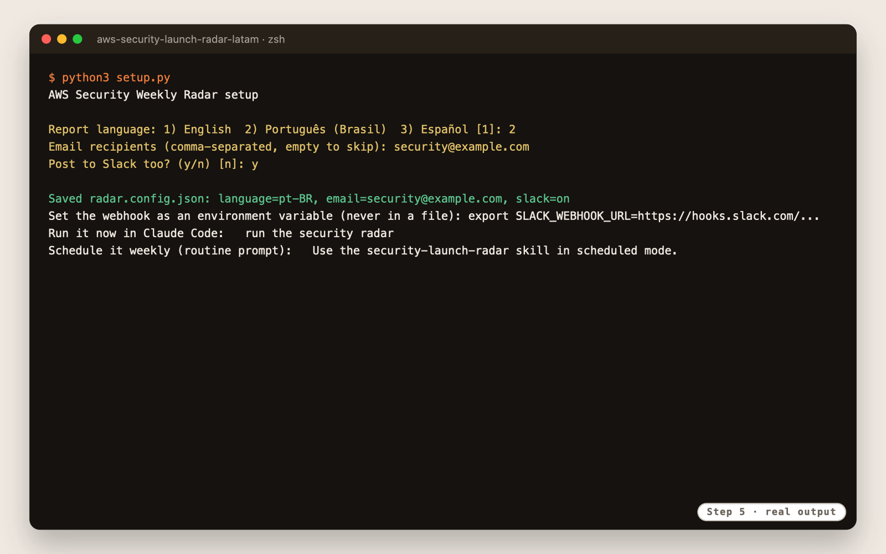

### Phase 2. Use

#### Step 6. Run the radar

Start Claude Code in the repository folder and ask:

```text
claude
> run the security radar
```

| Stage | What happens |
|---|---|
| Collect | `fetch_feeds.py` writes `out/items.json` with the week's security items |
| Curate | Three `radar-curator` subagents write `out/drafts/` in parallel; Claude merges them into `out/radar.json` |
| Review | The `radar-reviewer` subagent checks the radar against the items and writes `out/review.json` |
| Validate | `validate_radar.py` checks the draft; Claude fixes it if needed, up to 3 times |
| Render | `render.py` writes `out/email.html`, `out/email.txt` and `out/slack.json` |
| Preview | Claude shows the result and **asks before sending** |
| Deliver | Gmail connector sends the email; `send_slack.py` posts to Slack |

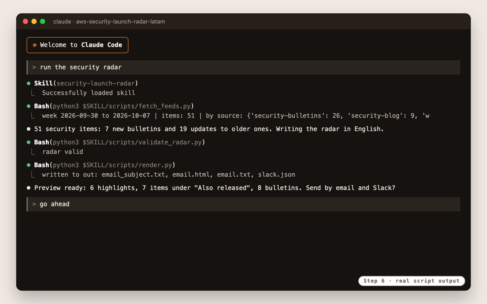

The email, as it lands in the inbox:

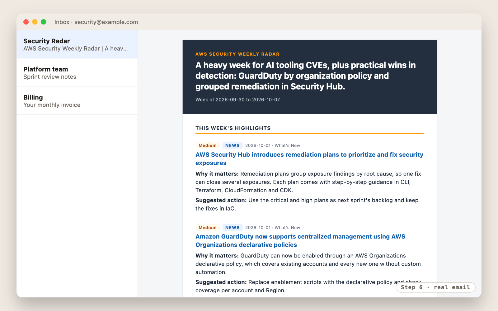

And the same review in Slack:

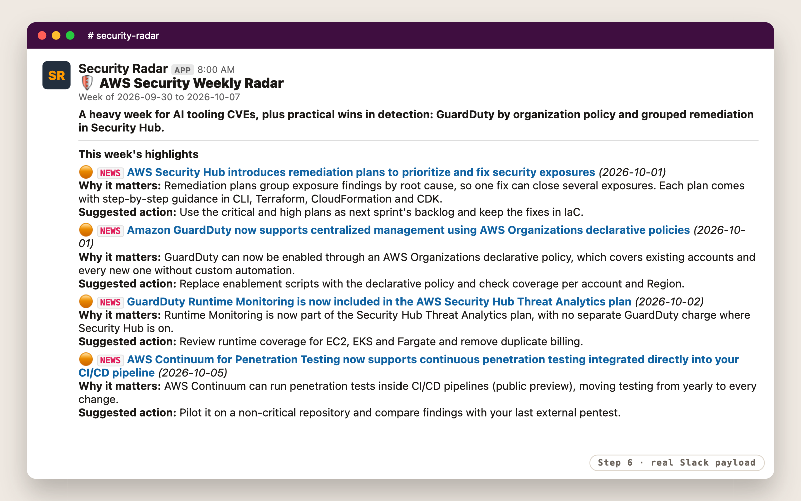

Open `out/email.html` in a browser to see the email exactly as it will arrive. Full examples in each language: `examples/email-en.html`, `examples/email-pt-BR.html` and `examples/email-es.html`.

**No connectors yet?** Run `python3 setup.py --language en` with no recipients. The radar still writes everything locally, including a LinkedIn post:

| File | What to do with it |
|---|---|
| `out/linkedin.html` | Open it, click **Copy post**, paste into LinkedIn. A second button copies the links for the first comment |
| `out/linkedin.txt` | The same post as plain text: `pbcopy < out/linkedin.txt` on macOS |
| `out/email.txt` | The full review as plain text |

The post uses Unicode bold for headings (LinkedIn has no markdown), keeps links out of the body and is shortened automatically to fit LinkedIn's 3,000-character limit. Examples: `examples/linkedin-en.txt`, `examples/linkedin-pt-BR.txt` and `examples/linkedin-es.txt`.

#### Step 7. Schedule it every Monday

In Claude Code, run `/schedule` and ask for a weekly routine on your private repository with this prompt:

```text
Use the security-launch-radar skill in scheduled mode.
```

Use a Monday cron in UTC, for example `0 11 * * 1` for 08:00 in São Paulo, attach the Gmail connector, and add `SLACK_WEBHOOK_URL` to the routine's cloud environment. In scheduled mode the skill never asks questions: if something is missing, it does not send and explains why in the run summary. Review or pause it at [claude.ai/code/routines](https://claude.ai/code/routines).

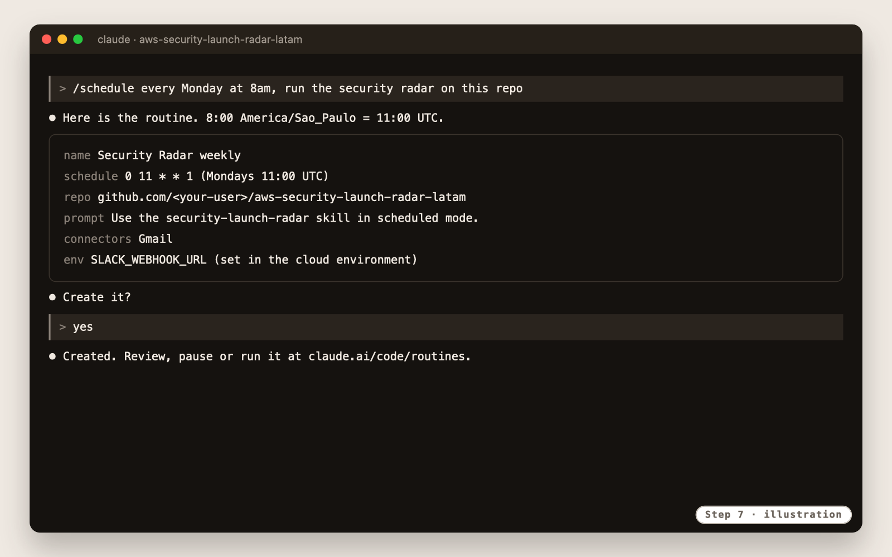

## Trust by design

| Shown in the report | Comes from |
|---|---|
| Titles, dates, links | `out/items.json`, collected from AWS |
| Severity, CVE IDs | The bulletin itself |
| NEWS, BLOG, UPDATED | The item's source and bulletin number |
| Headline, why it matters, action | Claude, checked by the validator |

The validator rejects anything that does not come from the week's items. `examples/radar-invalid.json` breaks the rules on purpose, and the CI makes sure it stays rejected:

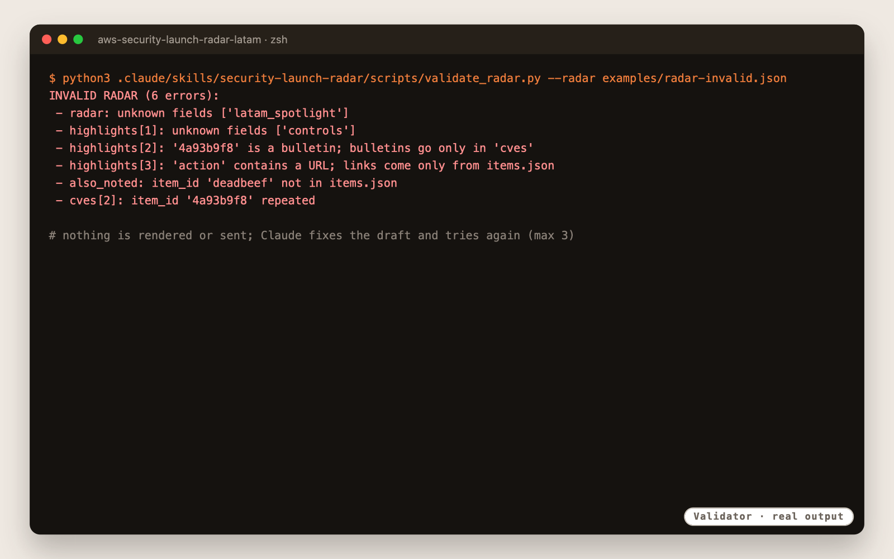

Feed content is treated as untrusted data: instructions found in a feed are never followed. The webhook URL lives only in an environment variable. Details in [docs/04-trust-and-security.md](docs/04-trust-and-security.md) and [SECURITY.md](SECURITY.md).

## How it works

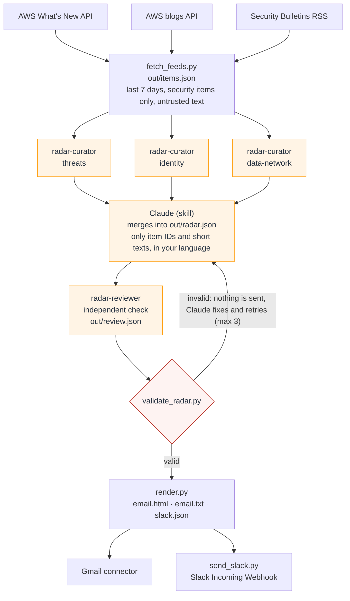

The agents are the only steps that write text. The reviewer checks it as an editor would, and the validator checks it again before anything is rendered or sent.

## Kit structure

```text
aws-security-launch-radar-latam/
├── README.md                     you are here
├── index.html                    kit page (GitHub Pages)
├── ROADMAP.md                    what comes after the MVP, with dates
├── STATUS-QUO.md                 adoption levels from 0 to 4
├── setup.py                      language and delivery, writes radar.config.json
├── radar.config.json             your settings (keep your copy private)
├── skills/                       the skill: SKILL.md, scripts and catalog (single source)
├── .claude/skills/               copy that Claude Code discovers, generated by the build
├── .claude/agents/               radar-curator and radar-reviewer subagents
├── templates/                    blank radar.config.json and radar.json
├── examples/                     one real week, sample radars and rendered reports in 3 languages
├── demo/                         20-minute script, opening deck and install timelapse
├── docs/                         install, flow, Claude Code features, trust, configuration, troubleshooting
├── scripts/build.py              syncs the skill, renders examples, checks docs (CI runs --check)
├── scripts/screenshots.py        renders the README screens (macOS)
└── assets/screenshots/           the screens of this README
```

## Roadmap

The MVP does one thing: the weekly review. Longer periods, personas, service filters, regulatory mapping for LGPD, BACEN and PCI DSS, and Kiro support are planned with dates in [ROADMAP.md](ROADMAP.md).

## Frequently asked questions

**Claude does not use the skill.** Start `claude` from the repository folder, where `.claude/skills/` lives.

**`fetch_feeds.py` shows an `ERROR`.** One source could not be reached. The others still work; check proxy and firewall.

**Old bulletins show up.** AWS sometimes updates old bulletins. They appear tagged **UPDATED**, after the new ones, and only when relevant.

**Nothing was sent.** The validator failed three times, or the Gmail connector or webhook is missing. The run summary says which.

**Can I get a monthly or YTD report, or only GuardDuty?** Not in the MVP. See [ROADMAP.md](ROADMAP.md).

More in [docs/06-troubleshooting.md](docs/06-troubleshooting.md).

## Contributing

Issues and pull requests are welcome.

- The source of the skill is `skills/security-launch-radar/`. Do not edit `.claude/skills/` or the rendered files in `examples/`: run `python3 scripts/build.py`.
- The CI runs `python3 scripts/build.py --check` and fails if the skill copy, the examples or the docs are out of date, or if the invalid example stops being rejected.
- Never put real recipients, webhook URLs or internal data in examples. The build rejects email addresses outside the fictional domains.

## License

MIT-0. See [LICENSE](LICENSE). Examples use one real week of public AWS news; every person and address in them is fictional.
